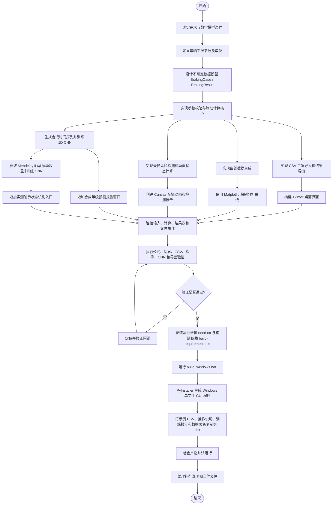
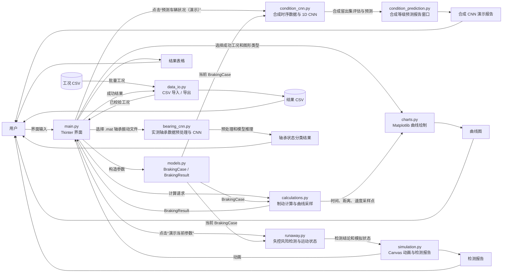
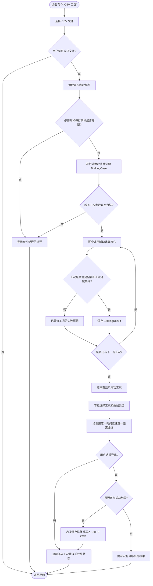
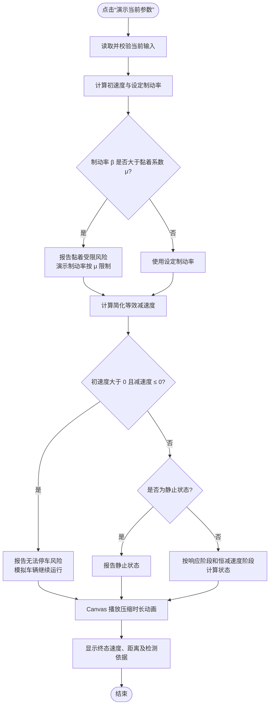
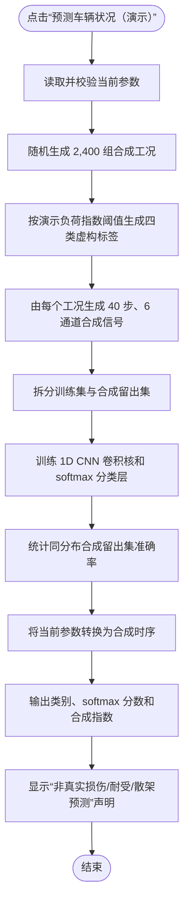
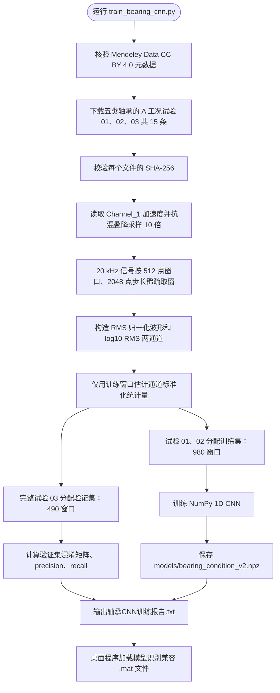
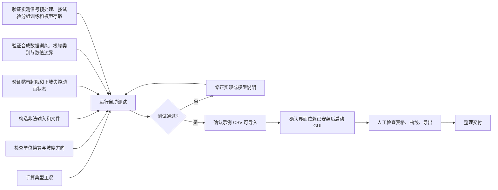

# 铁路车辆制动性能计算与分析程序——软件设计流程

## 1. 总体设计流程



## 2. 程序模块与数据流



## 3. 单工况计算流程

```mermaid
flowchart TD
    A([接收 BrakingCase]) --> B{参数是否通过模型校验?}
    B -- 否 --> E[抛出参数错误]
    B -- 是 --> C{制动率 β 是否不大于黏着系数 μ?}
    C -- 否 --> E
    C -- 是 --> D[初速度换算：v0 = km/h ÷ 3.6]
    D --> F[计算等效减速度<br/>a = g × (β + cr + i/1000) ÷ (1 + γ)]
    F --> G{v0 > 0 且 a ≤ 0?}
    G -- 是 --> E
    G -- 否 --> H{v0 是否大于 0?}
    H -- 否 --> I[停车时间、距离置为 0]
    H -- 是 --> J[响应距离 sr = v0 × tr]
    J --> K[制动时间 tb = v0 ÷ a]
    K --> L[制动距离 sb = v0² ÷ 2a]
    I --> M[计算力、总停车距离和总时间]
    L --> M
    M --> N{结果是否为有限数值?}
    N -- 否 --> E
    N -- 是 --> O[生成响应段与制动段曲线采样点]
    O --> P[返回 BrakingResult]
    E --> Q([向界面报告错误])
    P --> R([显示结果并允许导出])
```

## 4. 批量导入及结果展示流程



## 5. 计算模型与接口约定

### 输入参数

| 字段 | 含义 | 单位/约定 |
|---|---|---|
| `name` | 工况名称 | 非空文本 |
| `mass_kg` | 车辆质量 | kg，必须大于 0 |
| `initial_speed_kmh` | 初速度 | km/h，不小于 0 |
| `braking_ratio` | 制动率 β | 无量纲，`0 < β ≤ 1` |
| `response_time_s` | 制动响应时间 | s，不小于 0 |
| `grade_permille` | 线路坡度 i | ‰，上坡为正，下坡为负 |
| `basic_resistance_coefficient` | 基本运行阻力系数 cr | 无量纲，不小于 0 |
| `rotating_mass_factor` | 旋转质量换算系数 γ | 无量纲，不小于 0 |
| `adhesion_coefficient` | 轮轨黏着系数 μ | 无量纲，`0 < μ ≤ 1` |

### 计算关系

初速度换算为 `v0 = initial_speed_kmh / 3.6`。响应阶段假设速度不变：

```text
响应距离 sr = v0 × tr
等效减速度 a = g × (β + cr + i/1000) / (1 + γ)
制动时间 tb = v0 / a
制动距离 sb = v0² / (2a)
总停车距离 s = sr + sb
总时间 t = tr + tb
```

当初速度大于 0 且 `a ≤ 0` 时，不计算停车结果；当 `β > μ` 时，工况因不满足简化黏着判据而不计算。初速度为 0 时，停车距离和时间均为 0。

### 文件和模块边界

- `models.py`：定义参数、曲线采样点和计算结果的数据结构，并校验参数范围。
- `calculations.py`：提供纯计算函数 `calculate_braking(case, samples=100)`，生成结果及曲线采样点。
- `data_io.py`：提供 `load_cases(path)` 读取输入工况，以及 `export_results(path, results)` 导出成功结果。
- `charts.py`：将计算结果绘制为“速度—时间”或“速度—距离”曲线。
- `runaway.py`：按简化黏着限制和净减速度计算失控风险分类，并提供动画时刻的距离、速度状态。
- `simulation.py`：显示 Canvas 车辆动画，并在动画结束后生成失控检测报告。
- `condition_cnn.py`：提供可训练的 NumPy 1D CNN；合成教学数据生成器继续使用该模型。
- `bearing_cnn.py`：读取 MATLAB 加速度信号、抗混叠降采样、分窗，训练或加载五类轴承状态模型。
- `download_bearing_dataset.py`：从 Mendeley Data 官方接口下载所选记录并校验 CC BY 4.0 许可和 SHA-256。
- `train_bearing_cnn.py`：按完整试验记录分组训练/验证、保存模型和生成训练报告。
- `condition_prediction.py`：后台训练 CNN，在 Tkinter 窗口显示合成等级、概率输出和模型边界说明。
- `main.py`：协调界面输入、计算、曲线、演示窗口、合成预测窗口和文件对话框。
- `build-requirements.txt`：声明构建工具 PyInstaller，不作为软件运行依赖。
- `build_windows.bat`：安装构建工具、生成 `dist/RailwayVehicleBrakeAnalyzerV2.exe`，并复制示例工况与操作说明。
- `tests/`：验证模型公式、输入边界、曲线终点以及 CSV 读写。

## 6. 失控检测和动画流程



失控检测只采用两项教学判据：制动率超过黏着系数；黏着限值修正后，正初速度下等效减速度不大于 0。该检测不对真实车辆作安全保证。

## 7. 合成 CNN 等级预测流程



合成负荷指数的演示公式为：

```text
0.16 × 质量/40000
+ 0.28 × (速度/80)^2
+ 0.18 × 制动率/0.12
+ 0.12 × |坡度|/30
+ 0.26 × 制动率/黏着系数
```

类别边界 0.75、1.35 和 2.50 是为生成虚构标签而设置的任意教学阈值，不代表任何真实零件、材料或整车的耐受极限。合成留出集准确率只衡量 CNN 对这套合成规则的拟合效果，softmax 输出不是实际损坏概率。极端类别不表示车辆真实散架。

## 8. 实测轴承 CNN 训练流程



数据源为 Mendeley Data 版本 2 `Bearing Vibration Data under Time-varying Rotational Speed Conditions`，DOI `10.17632/v43hmbwxpm.2`，CC BY 4.0。全数据集有 60 条记录，即五种轴承状态 × 四种变速工况 × 每种三次试验；仅纳入 A（转速递增）工况。每条原始记录为 200 kHz、10 秒，包含振动加速度 `Channel_1` 和编码器转速 `Channel_2`，本模型不读取后者。五类状态由官方文件名前缀标注。

抗混叠多相滤波后采样率为 20 kHz，因此 512 点窗口对应 25.6 ms，2048 点窗口步长对应 102.4 ms；该步长大于窗口长度，是稀疏取窗而非重叠窗口。每个窗口的两个输入通道分别为去均值后按窗口 RMS 归一化的波形及 `log10(RMS)` 强度特征。训练和验证按完整试验划分，避免同一记录的窗口同时出现在两组。训练集的标准化统计量不使用验证数据计算。

网络为 NumPy 手写 1D CNN：12 个宽度为 5 的卷积滤波器、ReLU、全局平均池化、全连接 softmax 五分类层；交叉熵通过反向传播优化，批量 64、80 轮、学习率 0.035。权重初始化种子为 2026，训练批次打乱种子为 2027。留出准确率为 62.86%（308/490），复合故障 recall 为 36.73%；完整混淆矩阵和每类 precision/recall 见训练报告。窗口级指标并不等于独立试验级评估，验证也仅覆盖同一数据源、设备及转速递增工况。

该训练任务只识别所选实验台轴承类别，不能外推为铁路车辆轴箱、整车损坏、材料耐受极限或散架预测。softmax 分数未校准，不代表故障概率，不能用于铁路安全或维修决策。

## 9. 验证流程



在 `newvers` 目录执行测试：

```powershell
python -m unittest discover -s tests -v
```

最终版本的自动化测试共 30 项；测试通过不代表轴承模型具备跨设备、跨工况或铁路车辆实车诊断能力。

安装图形界面、数值计算、MAT 文件读取和信号滤波所需的依赖并启动程序：

```powershell
python -m pip install -r need.txt
python main.py
```

Windows 下生成单文件 GUI 程序：

```bat
build_windows.bat
```

构建产物位于 `newvers/dist/`。打包脚本使用上一级目录项目 `.venv` 中的 Python；构建依赖单独列在 `build-requirements.txt`，与运行依赖 `need.txt` 分开管理。

## 10. 模型适用范围

本设计面向课程学习，采用单车辆恒定制动率和恒定基本运行阻力系数模型；忽略制动系统建立过程的连续变化、车辆间纵向冲动和制动系统温升。制动率与黏着系数的比较是简化检查，并非完整轮轨黏着校核。合成 CNN 仅展示算法流程；公开数据 CNN 只学习特定实验台轴承数据中的五类状态，不代表铁路轴箱或车辆部件的实测诊断能力。两种模型均不预测车辆耐受极限或散架风险，软件输出不用于铁路运营、安全决策或工程设计定型。
